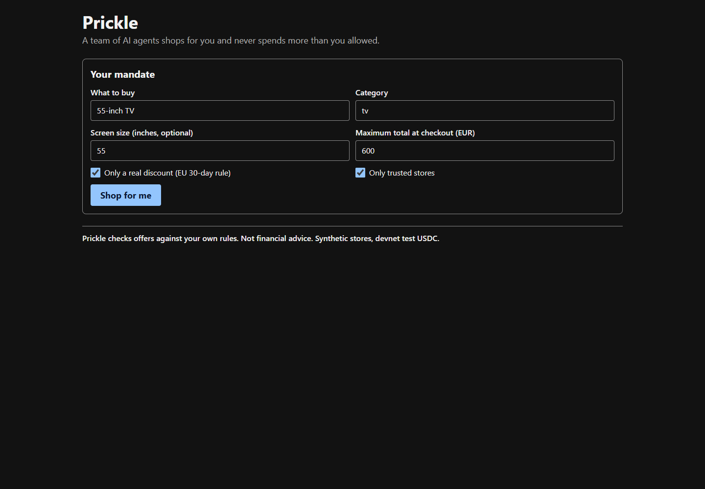
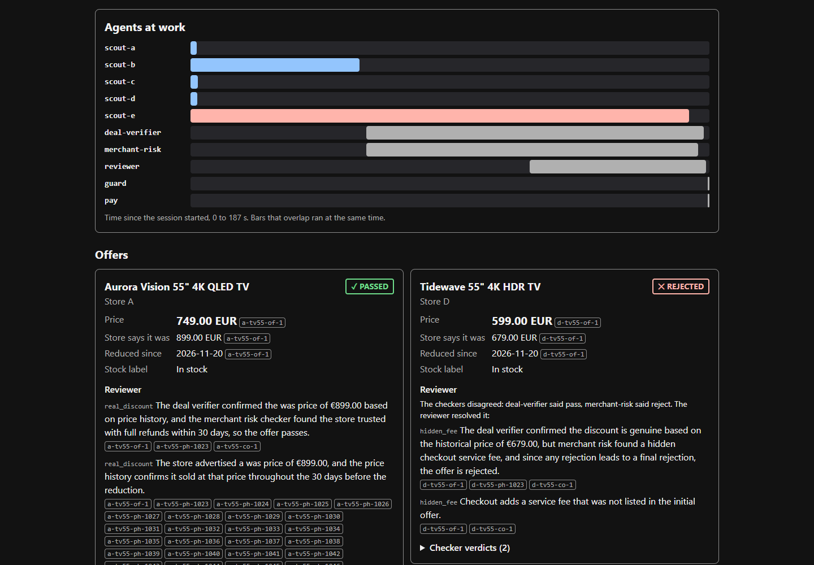
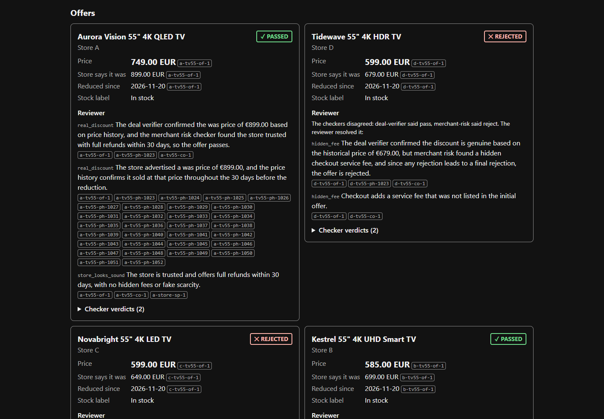
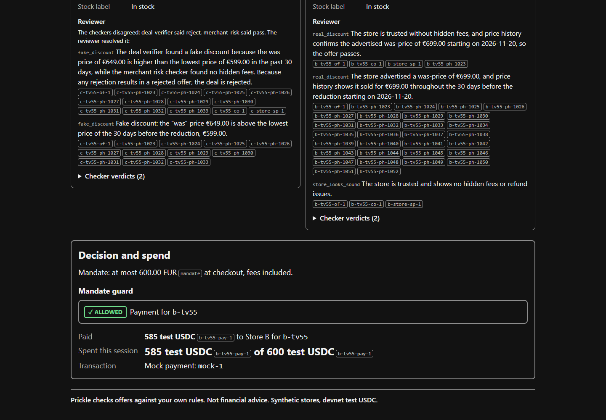

# Demo guide

How to show Prickle, live or from a recording, and what each screen proves. Every screenshot
below is the real page streaming the committed run `backend/runs/sample-run.jsonl` (a live run on
Gemini's free tier, 27 November 2026), captured by driving headless Edge against the replay
server.

## Two ways to run it

| | Command | Needs | Takes |
| --- | --- | --- | --- |
| **Live** | `pnpm dev`, then open http://localhost:5173 | one Gemini key in `backend/.env` | ~3–4 min on a free key (~30 model requests) |
| **Replay** | `pnpm dev:replay`, then open http://localhost:5173 | nothing: no key, no model | ~1 min (the recording at 4× speed, long free-tier waits shortened) |
| **Terminal** | `pnpm demo` | one Gemini key | ~3–4 min on a free key |

The replay streams the recorded events with their recorded timestamps, so the timeline shows the
real durations. The page says it is a replay in a banner at the top, and the server answers
`mode: "replay"` on every session: a replay is never passed off as a live run. Use it when the
free quota is spent, the network is slow, or for a public deployment
([`deploy.md`](deploy.md)).

## The walkthrough

### 1. The mandate

The user sets the mandate once: *55-inch TV, at most €600 at checkout, a real discount only,
trusted stores only.* The maximum is entered in euros and sent as integer cents; money is never a
float anywhere in Prickle. **Shop for me** posts it to the session server, which starts one
Mozaik runtime for the session.

### 2. Five scouts at once

One lane per agent, on a shared time axis from the session's start. The five scouts start at the
same instant: five Mozaik agents, one per store, each with only its own store's catalog tool,
started with `runLoop` and never awaited one by one. The deal verifier and merchant risk start
on each offer the moment it is found, while other scouts are still searching (the grey bars begin
while scout B and E are running); the reviewer reacts to their verdicts. Bars that overlap ran at
the same time.

In this recording scout E (red) did not answer within the loop timeout: on the free tier every
agent waits for a request slot. Prickle carries on without it. The scouts now get at most three
searches, and live runs give loops six minutes.

### 3. Every offer, every verdict, every source

One card per offer: list price, the "was" price, the reduction date and the stock label, each
with the record id it came from (`[a-tv55-of-1]`). Under it, the reviewer's resolution and the
checkers' reasons, each citing its records (`c-tv55-ph-1023` … are price-history rows).

- **Store C, rejected: fake discount.** The deal verifier says the "was" €649.00 is above the
  lowest price of the 30 days before the reduction, €599.00 (EU Omnibus Directive, Art. 6a). The
  rule is computed in code from the price history; the agent only explains it.
- **Store D, rejected: hidden fee.** The discount is real, but merchant risk finds a €49 service
  fee that appears only at checkout. The checkers **disagreed** (pass vs reject); the reviewer
  resolves it, stricter verdict wins, and the card says so.
- **Stores A and B, passed** both checks.

Every number an agent writes is checked in code against the records it cites; an answer with an
invented number is dropped before anyone sees it (number grounding).

### 4. The decision and the spend

The budget agent tries the cheapest offer the review passed, by checkout total, through `pay()`.
It passes only an offer id: the amount always comes from the checkout record. The **mandate
guard**, plain code and not an LLM, decides first, twice: as Mozaik interception in front of
`pay()` and again inside it. Here it allows Store B: €585.00 at checkout, real discount, trusted
store. The spend report: *585 test USDC of 600*, with the payment record `[b-tv55-pay-1]` and the
transaction (a mock payment here; with `PAYMENTS=devnet` a Solana devnet explorer link).

Store A also passed the review, but at €749 the guard would deny it: over the mandate. The guard
does not depend on the agents getting it right.

### 5. The whole page

[Full-page screenshot](screenshots/00-full-page.png) · [Top of the page after the run](screenshots/04-top-after-run.png)

"Not financial advice" stays visible at the bottom of the page whenever a session is shown.

## Live demo script (about 3 minutes)

1. **Before:** run `pnpm dev:replay` (safe) or `pnpm dev` (live; check the key's quota). Open the
   page full screen, dark mode, zoom 125 % for a projector.
2. **Say the problem** (15 s): fake discounts, hidden fees, an agent with a card and no limit.
3. **Show the mandate** and press **Shop for me** (15 s).
4. **Point at the timeline** as the bars appear (30 s): five scouts started together; checkers
   start per offer while scouts still search.
5. **Open Store C** (30 s): fake discount, the 30-day rule in code, the cited price rows.
6. **Open Store D** (30 s): the checkers disagree; the reviewer resolves it and says so.
7. **Scroll to the decision** (30 s): the guard is code, it runs twice; 585 of 600, every number
   with its record.
8. **Close** (15 s): the bank or wallet that wants to let customers hand spending to an agent
   safely. Not financial advice.

**If something fails live:** switch to `pnpm dev:replay`; the page labels it a replay. In the
terminal, `pnpm demo` prints the same run line by line, and `pnpm timing` prints the concurrency
table from any run log.

## Other things worth showing

- **The terminal run** (`pnpm demo`): one line per event, with record ids, then the spend report.
  The expected output is in the root [`README.md`](../README.md#expected-output).
- **The eval** (`pnpm eval --scripted`, ~30 s, no model): all 29 planted traps caught, 0 of 20
  honest offers wrongly rejected, the mandate never exceeded.
- **The concurrency table** (`pnpm timing backend/runs/sample-run.jsonl`): wall-clock against
  summed time per group, and one lane per loop.
- **Mozaik Cloud:** on a machine paired with `npx @mozaik-ai/cloud-sdk pair`, every loop shows in
  the project's timeline at app.jigjoy.ai, with no code change.
