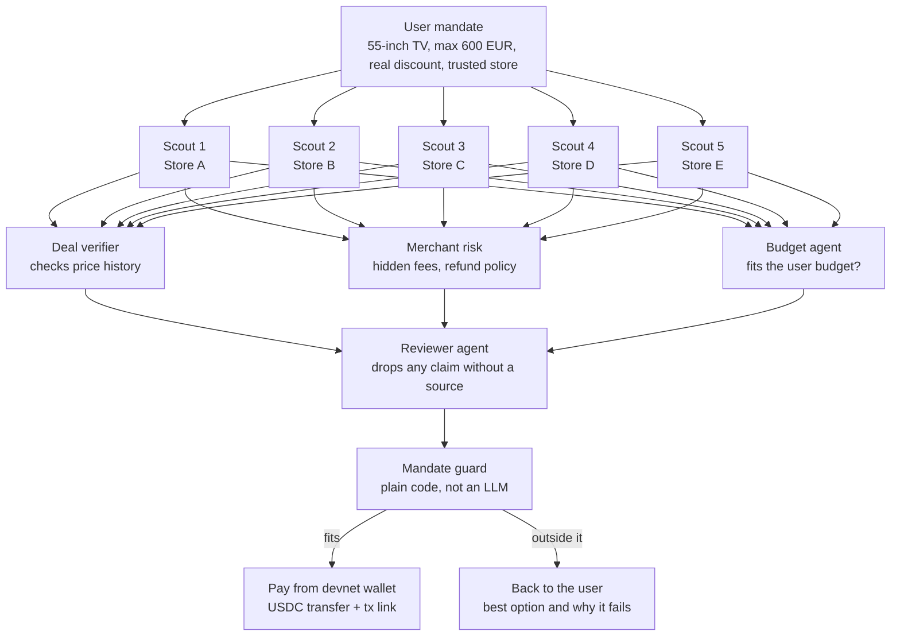

# Prickle: Black Friday shopping agent with a budget

Team Prickle: Maksim Privalov, Tara Petričić · Mozaik Black Friday AI Hackathon, 26–27 November 2026 · Category: Agentic Payments

## Summary

**Prickle is a team of AI agents that shops for you on Black Friday, pays from a capped wallet, and never spends more than you allowed.**

**Pitch line:** *A prickle is a group of hedgehogs. Ours is a group of agents that shops, checks every discount and pays, within the limits you set.*

**The problem.** On Black Friday, shoppers face three traps:

- **Fake discounts:** the store raises the price weeks before, then "cuts" it back.
- **Hidden fees:** a €599 price becomes €648 at checkout.
- **Overspending:** a shopping agent with a card and no limits can spend more than the person meant.

**The solution.** The user gives a mandate, for example *"Buy a 55-inch TV, at most €600, only a real discount, only trusted stores."* Scout agents search several stores at the same time. Checker agents verify each offer against price history and store signals. A mandate guard written in plain code lets the payment through only if it fits the mandate. The payment is a real test transaction on Solana devnet, so every euro spent points to a transaction record.

**Not financial advice.** Prickle checks offers against the user's own rules; the output states that it is not financial advice.

## How it works

**The user sets a mandate once; five scouts search in parallel, three checkers judge each offer, and only the guard can release money.**



**Example run** (synthetic data):

1. The user sets the mandate: 55-inch TV, at most €600, real discount only, trusted stores only.
2. Five scouts query Stores A–E at the same time and publish each matching offer as an `offer.found` event.
3. For each offer, the deal verifier, merchant-risk and budget agents run together. Store C's €599 TV was €599 in October and €649 on 1 November: a fake discount, citing the price-history rows. Store D's €599 TV becomes €648 at checkout because of a €49 service fee, citing the checkout breakdown. Store B's €585 TV was €699 for 60 days and has a 30-day refund policy: it passes.
4. The reviewer confirms every verdict points to its source records and drops any that do not.
5. The mandate guard sees €585 ≤ €600, a trusted store and a verified discount, so it releases the payment: 585 test USDC on devnet, with the transaction link in the spend report.
6. If no offer fits, Prickle returns to the user with the best option and the reason it falls outside the mandate.

## Mozaik design

**One Mozaik runtime per shopping session; agents coordinate through shared state and events, not a central orchestrator.** The rules require `@mozaik-ai/core` and two or more concurrent agents, and concurrency carries the most weight in judging, so the design makes it visible.

| Prickle part | Mozaik concept | Runs concurrently? |
| --- | --- | --- |
| Shopping session | runtime (`defineRuntime`) | — |
| Mandate, offers, verdicts, budget, wallet status | shared state: our own `RuntimeState` subclass | — |
| The user (sets the mandate, approves exceptions) | human participant (`createHuman`) | — |
| Scout agent, one per store (5 stores) | 5 agents (`createAgent`), each started with `runLoop`, not awaited | yes, all 5 at once |
| Budget agent | agent started at the same time as the scouts | yes |
| Deal verifier, merchant-risk agent | situation handlers on the `offer.found` event | yes, both on each offer as it appears |
| Reviewer agent | agent that reacts to the other agents' answers (critique loop) | yes |
| Store catalog, price history, checkout total, `pay()` | tools (`FunctionTool`) over our mock store API and Solana | — |
| Mandate guard | interception: blocks a payment step before it runs | — |

**Two things to point out to the judges:**

- **Composition by reaction.** Nobody calls the verifiers; they react to `offer.found` events. Adding the reviewer needs no change to the other agents.
- **The guard is not an LLM.** Interception rewrites or blocks a loop transition before it runs, so an attempt to pay €648 against a €600 mandate never reaches the wallet.

**Demo proof:** pair the app with Mozaik Cloud (`npx @mozaik-ai/cloud-sdk pair`) so the timeline shows the five scout loops running side by side.

*Open item: exact function signatures still to be checked in the Mozaik Quickstart and the mozaik-examples repo.*

## Technology stack

**One language end to end: TypeScript on Node.js, because Mozaik is a TypeScript runtime and two people have no time for a second stack.**

| Layer | Choice | Why |
| --- | --- | --- |
| Language and runtime | TypeScript on Node.js (LTS), pnpm | Mozaik is TypeScript; one language for agents, API and UI |
| Agents | `@mozaik-ai/core` 4.x | required by the rules; events flow to Mozaik Cloud with no code changes |
| LLM models | a provider bundled with Mozaik; a fast, cheap model for scouts, a stronger one for the reviewer | scouts run many times, the reviewer decides |
| Schemas | `zod` for every agent output, tool input and event payload | structured output is checked before anyone trusts it |
| Mock store API | small HTTP server (Hono or Fastify) serving the synthetic stores | looks real in the demo; ready for x402 later |
| Synthetic data | JSON fixtures from a seeded generator script, committed to the repo | same data on every run, so the eval is reproducible |
| Payments | `@solana/web3.js` + SPL token library on devnet; mock wallet as fallback | real test transactions with a link per payment |
| Money math | integers only: euro cents and USDC base units (6 decimals) | no rounding errors in the guard or the ledger |
| Run log | append-only JSONL file of every event | the source for every number in the spend report and the eval |
| UI | terminal output first; Vite + React page streaming events over SSE if time allows | the UI is the first thing to cut |
| Tests | Vitest for the guard, money math and traps | the guard must be proven, not trusted |
| Observability | Mozaik Cloud | shows the parallel loops live in the demo |

## Portability: leaving Mozaik later

**Only one folder imports Mozaik, so moving to another framework later means rewriting one adapter, not the product.** The rest of the code knows nothing about Mozaik.

```text
prickle/
  src/
    core/        domain types, money math, mandate guard (no framework imports)
    agents/      agent specs: name, prompt file, tools, output schema, events it reacts to
    prompts/     one .md prompt per agent
    tools/       plain async functions with zod schemas: store API, price history, pay()
    runtime/
      port.ts    our own interface: start an agent, publish an event, react to an event, shared state
      mozaik/    the ONLY place that imports @mozaik-ai/core
      plain/     optional: Promise.all + EventEmitter, for tests and as proof of portability
    app/         wires a runtime adapter to the agents; CLI and UI entry points
  data/          synthetic fixtures
  LICENSE
```

**The rules that keep it portable:**

- **Our events, our names.** `offer.found`, `verdict.ready` and `payment.requested` are typed in `core/`; the Mozaik adapter maps them to Mozaik semantic events.
- **Agents are plain data.** An agent spec is an object with a prompt, tools and a zod output schema; the adapter turns it into a Mozaik agent.
- **The guard does not depend on the framework.** `pay()` itself refuses any payment outside the mandate. Mozaik interception is a second, visible layer for the demo.
- **Enforced by lint.** ESLint `no-restricted-imports` blocks `@mozaik-ai/core` outside `runtime/mozaik/`.

**Keep it thin.** The adapter must still use real Mozaik features (concurrent loops, situation handlers, interception), because that is what the judges score. Budget about one hour for this layer; don't build a framework of our own.

## Payments

**The agent pays from a Solana devnet wallet with test USDC, and every payment is a transaction anyone can open in the Solana explorer.** Devnet uses test money only, which satisfies the rule against real money movement.

| Part | How it works |
| --- | --- |
| Wallet | Solana devnet wallet funded with test USDC up to the mandate (e.g. 600 USDC) |
| Payment | `pay(store, amount)`: a devnet USDC transfer to the store's address (`@solana/web3.js` + SPL token library) |
| Mandate guard | plain code checks amount ≤ mandate, store trusted, discount verified, before `pay()` runs; anything outside the mandate goes back to the user |
| Spend report | "Spent 585 of 600 USDC" with the transaction signature for each payment |
| Optional later | Kora as a policy-enforced signer, so the wallet itself refuses to sign above the limit |
| Optional bonus | the price-history API charges a few cents per request over x402 (HTTP 402 Payment Required), paid from the same budget |

**Fallback:** if the devnet payment does not work by 17:00 on Thursday, `pay()` switches to a mock wallet. Only that one file changes; the agents stay the same.

*To check: test USDC from Circle's faucet on Solana devnet.*

## Synthetic data and eval

**All stores, products and price histories are synthetic, and a red-team agent plants traps in them so we can measure how many Prickle catches.** The rules allow only synthetic or public data.

**Dataset:** 5 mock stores, about 40 offers for the demo products, each with a 60-day price history, a checkout breakdown and store details (domain age, return policy).

| Trap | What the store does | Which agent should catch it |
| --- | --- | --- |
| Fake discount | raises the price weeks before, then "cuts" it | deal verifier (price history) |
| Hidden fee | adds a "service fee" only at checkout | merchant-risk agent (checkout total) |
| Fake scarcity | shows "only 2 left!" on every product | merchant-risk agent |
| No refund policy | missing or "all sales final" policy | merchant-risk agent |
| Over budget | real deal, but above the mandate | mandate guard |

**Eval in the README:** run every offer through Prickle and report how many traps were caught, how many honest deals were wrongly rejected, and confirm the mandate was never exceeded. Every number in the table comes from the run's log, not typed by hand.

## Scoring

**A strict re-check puts the idea at 82/100 today. Six fixes bring it to about 94, and the first three are must-haves.** Criteria from the [track brief](https://build.jigjoy.ai/tracks/finance); the [rules](https://build.jigjoy.ai/rules) add that concurrency gets the most weight. Scores are our own estimate, not the judges'.

| Criterion | Max | Now | After fixes | What judges look for | Our biggest risk |
| --- | --- | --- | --- | --- | --- |
| Useful: it solves a finance problem someone has | 30 | 24 | 27 | a real person with a real money problem | "a shopping gimmick, not finance" |
| Multi-agent design on Mozaik: agents in parallel, shared state, checks between them | 30 | 26 | 29 | agents really run at the same time, share state and check each other | "the 5 scouts are one agent in a loop" |
| It works: we can run it from the README | 25 | 19 | 23 | clone, follow the README, it runs | LLM key, Solana faucet and setup steps fail on a judge's machine |
| Care with financial data: sources shown, no invented numbers | 15 | 13 | 15 | every number has a source; nothing is made up | an LLM retypes a price wrong in its explanation |
| **Total** | **100** | **82** | **94** | | |

### Useful (30): now 24, target 27

- **Strong:** fake discounts and hidden fees are a real Black Friday problem, and agents that spend money need limits. It fits the Agentic Payments category.
- **Gap:** judges may see a consumer shopping toy. The finance part (payments, limits, budget) has to lead the pitch.
- **Fix 2** makes "fake discount" an objective, legal test. **Fix 6** names who pays for this.

### Multi-agent design on Mozaik (30): now 26, target 29

- **Strong:** 5 scouts run in parallel, 3 checkers run in parallel on each offer, shared state holds the mandate and verdicts, the reviewer checks the others, the guard blocks the payment.
- **Gap:** if all 5 scouts call the same tool on the same data format, judges may say it is one agent in a loop. Agents never disagree, so "checks between them" looks thin.
- **Fixes 1, 4 and 5** close it.

### It works (25): now 19, target 23

- **Strong:** synthetic fixtures, mock-wallet fallback, one `pay()` function to swap.
- **Gap:** this is where hackathon projects lose the most. A judge needs an LLM key, Node, maybe a Solana wallet, and one broken step means zero.
- **Fix 3** closes it.

### Care with financial data (15): now 13, target 15

- **Strong:** prices come from price-history records, payments from devnet transactions, a reviewer drops unsourced claims, outputs say "not financial advice".
- **Gap:** the reviewer is itself an LLM. If an agent writes "was €649" when the record says €639, another LLM may miss it.
- **Fix 1** closes it with code, not another prompt.

### The six fixes, in priority order

| # | Fix | Effort | Criteria it lifts |
| --- | --- | --- | --- |
| 1 | **Number-grounding check in code.** Every number in an agent's output (price, fee, date, balance) must match a value a tool returned in this run, with its record id. Anything else is rejected before the reviewer sees it. | ~1 h | Data care +2, Multi-agent +1 |
| 2 | **EU 30-day rule in the deal verifier.** Under the Omnibus Directive (Article 6a), an announced price reduction must be shown against the lowest price in the 30 days before it ([source](https://www.rpclegal.com/snapshots/consumer/spring-2022/european-commission-publishes-guidance-on-price-promotions-under-the-omnibus-directive/)). The verifier computes that lowest price from the history and compares it with the store's "was" price: a test with a rule and a source, not an LLM opinion. | ~1 h | Useful +2, Data care |
| 3 | **Judge mode by default.** `pnpm install && pnpm demo` runs on synthetic data with the mock wallet. `.env.example` needs one LLM key; Solana devnet is opt-in (`PAYMENTS=devnet`). The README shows the expected output and a committed sample run log. Test it on a clean clone before submitting. | ~1.5 h | Works +4 |
| 4 | **Different scouts, real disagreement.** Each mock store answers in a different shape (clean JSON, messy product text, paged catalog), so each scout has real work. When the deal verifier and merchant-risk agent disagree on an offer, the reviewer resolves it and the decision is logged. | ~1.5 h | Multi-agent +2 |
| 5 | **Concurrency proof in the README.** The required "how agents run concurrently" section shows a timing table taken from the run log (5 scouts in parallel vs. their summed time) and a Mozaik Cloud screenshot. | ~30 min | Multi-agent +1 |
| 6 | **Name the user and the buyer.** Two users in the pitch: the shopper, and the bank or wallet that wants to let customers hand spending to an AI agent safely. | ~15 min | Useful +1 |

**Must-haves: fixes 1, 2 and 3.** Do 4 to 6 if time allows; they come before the x402 bonus and Kora.

## Plan

**Goal: one mandate running end to end by Thursday 20:00, demo-ready by Friday 17:00.** Split below is a first proposal; the agreed split and timeline are in [`work-split.md`](work-split.md).

| When | Goal |
| --- | --- |
| Thu until 14:00 | Mozaik mini-course; repo set up; synthetic dataset generated |
| Thu 15:00–20:00 | scouts + deal verifier running in parallel; first mandate end to end with mock wallet |
| Thu 17:00 | decision point: Solana devnet payment works, or stay on the mock wallet |
| Fri until 14:00 | merchant-risk, budget and reviewer agents; mandate guard as interception; spend report |
| Fri 15:00–17:00 | eval run, README, Mozaik Cloud pairing, demo rehearsal |
| Fri 17:00–19:00 | demos |
| Fri before 24:00 | final submission (repo, description, how agents run concurrently, demo video) |

**Maksim (payments core):**

- [ ] Mandate guard and interception
- [ ] `pay()` with Solana devnet USDC, plus the mock fallback
- [ ] Deal verifier and merchant-risk agent
- [ ] Spend report with transaction signatures

**Tara (data, agents, story):**

- [ ] Synthetic stores, offers, price histories and traps
- [ ] Scout agents and mock store API
- [ ] Simple UI or terminal view: mandate in, decisions out
- [ ] README, demo video, pitch

**Cut in this order if behind:** x402 bonus, Kora, the UI (terminal output instead), the Solana payment (mock wallet). Keep the parallel agents, the guard, the sources and the eval.

## Rules checklist and open questions

**Before submitting, every box below must be ticked.** Source: [hackathon rules](https://build.jigjoy.ai/rules) and [track brief](https://build.jigjoy.ai/tracks/finance).

- [ ] Built on `@mozaik-ai/core` with two or more concurrent agents (a single agent with many tools does not count)
- [ ] Core work done during the event
- [ ] Only synthetic or public data; no real accounts or real money (devnet only)
- [ ] Every number an agent reports points to its source
- [ ] Output states it is not financial advice
- [ ] Public GitHub repo with README: what it does, architecture, how to run it
- [ ] Submission includes project name, description and how the agents run concurrently
- [ ] Optional but recommended: demo video, screenshots
- [ ] Submitted before midnight CET, Friday 27 November (resubmitting is allowed)

**Open questions (ask in Discord or miodrag.todorovic@jigjoy.ai):**

- How do online teams present at the 17:00 demos, and do demos count toward the score?
- Are there sponsor prizes for building on Solana or Stripe?

## License and ownership

**The code and documents are ours: the repo ships with an all-rights-reserved license that lets only the hackathon judges run and evaluate it.** The hackathon rules say teams keep their IP, and submitting gives JigJoy a non-exclusive right to showcase the project ([rules §10](https://build.jigjoy.ai/rules)).

- **What the license covers:** source code, prompts, documentation, designs and the synthetic data set, copyright Maksim Privalov and Tara Petričić.
- **What it allows:** viewing the public repo, and running and evaluating it for judging. Nothing else without our written permission.
- **Third-party code keeps its own license.** Mozaik is MIT-licensed, so keep its notice wherever it is bundled.
- **The idea itself is not protected.** Copyright protects our code and texts, not the concept. Once the project is public and pitched, others may build something similar.
- **Both of us must agree.** Tara is a co-owner, so she should confirm the license before the first commit.

The license text is in the `LICENSE` file at the root of the repo. *We are not lawyers; for anything beyond the hackathon, such as a company or investors, get proper legal advice.*
